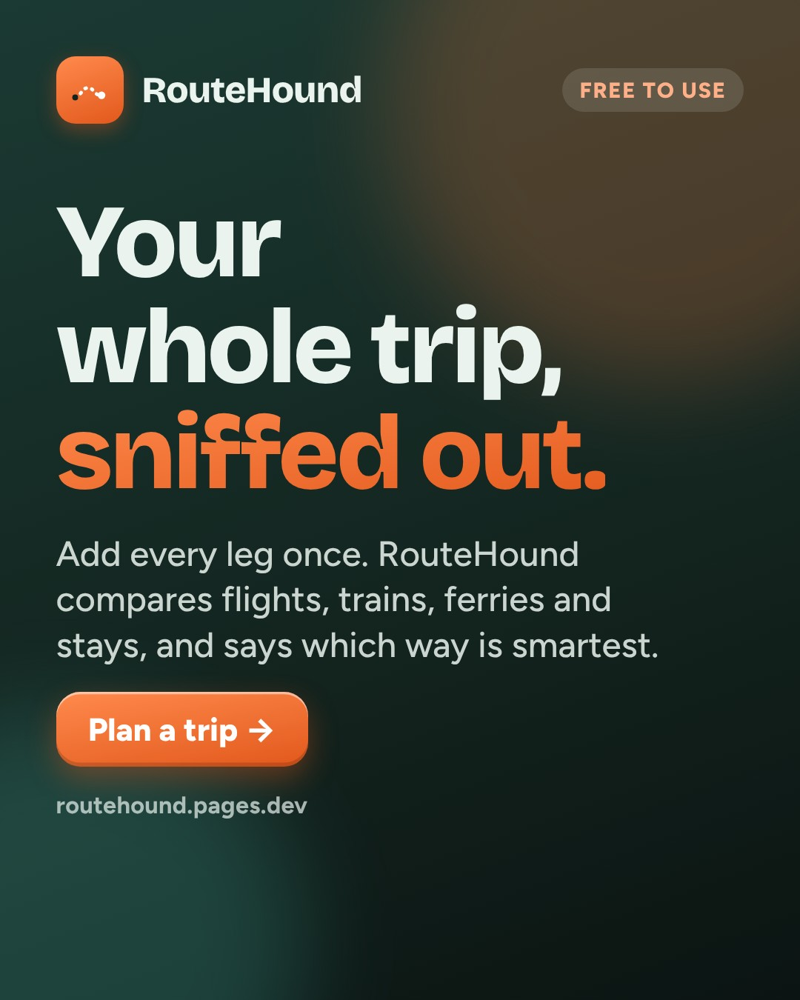
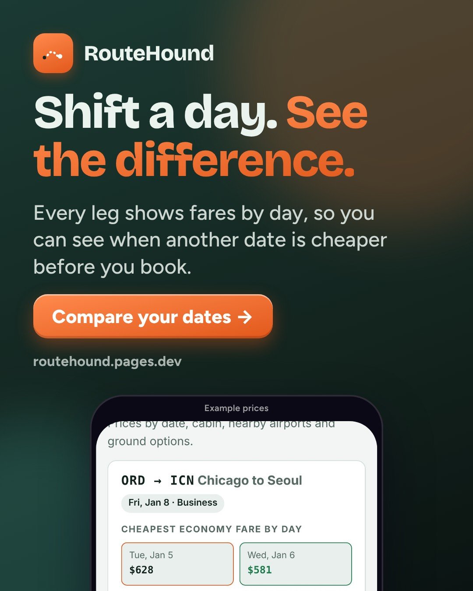
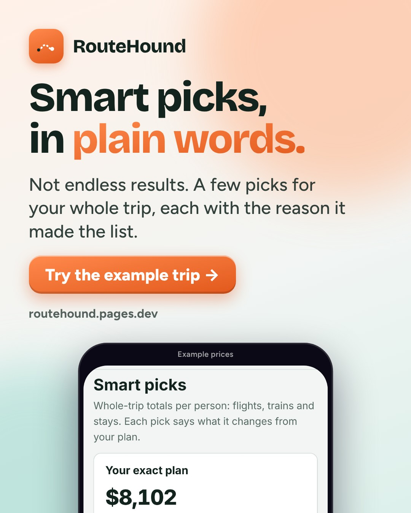
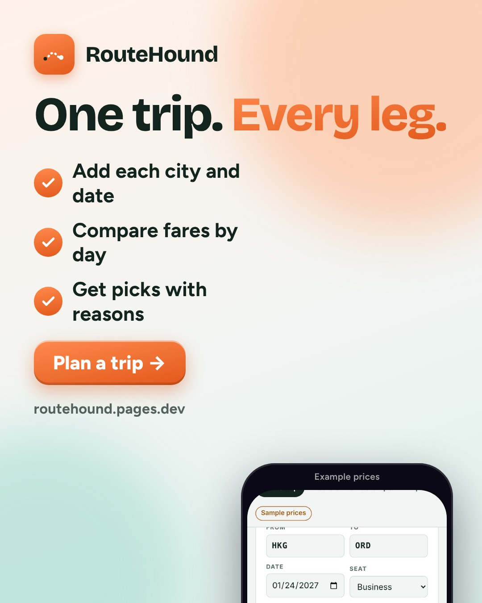
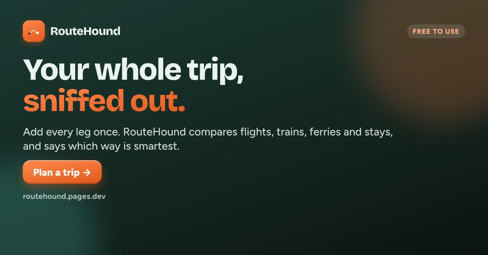

# RouteHound · week of 2026-11-09 · Plan the whole trip, not one flight

**Approve by merging this pull request.** Facebook and Instagram posts then go out at their times. Everything else is a ready-to-paste draft.
To change something, edit `marketing/campaigns/2026-11-09.json` and rebuild, or set `"skip": true` on a post. Delete a post to drop it.

**Goal:** First 100 trip searches from social; learn whether 'whole trip' or 'shift a day' messaging gets more clicks.
**Why this angle:** Holiday and winter-break trips are being booked now, and many of them are multi-city (visiting family abroad, big school-break trips). Each ad leads with one real feature so the tracked links show which one people want.

## facebook · Mon, Nov 9, 7:00 PM · auto after approval



```text
Planning a trip with more than one stop? Most flight sites search one leg at a time.

RouteHound lets you add the whole trip: every city and date. It compares flights, trains, ferries and stays, then gives you a few smart picks with the reason for each.

Free to use. https://routehound.pages.dev/?utm_source=facebook&utm_medium=social&utm_campaign=2026-11-09-plan-the-whole-trip-not-one-f&utm_content=fb-launch
```

_Posts automatically at the time shown after this is approved (merged)._

## facebook · Wed, Nov 11, 12:00 PM · auto after approval



```text
Flexible by a day or two? RouteHound shows each leg's fares by day, so you can spot a cheaper date before you book.

Try it with our example trip: https://routehound.pages.dev/?utm_source=facebook&utm_medium=social&utm_campaign=2026-11-09-plan-the-whole-trip-not-one-f&utm_content=fb-shift

(Some links are affiliate links; it doesn't change your price.)
```

_Posts automatically at the time shown after this is approved (merged)._

## facebook · Fri, Nov 13, 7:30 PM · auto after approval



```text
You don't need 300 results. You need the few that make sense for your trip, and why.

RouteHound's smart picks explain themselves in plain words. https://routehound.pages.dev/?utm_source=facebook&utm_medium=social&utm_campaign=2026-11-09-plan-the-whole-trip-not-one-f&utm_content=fb-picks
```

_Posts automatically at the time shown after this is approved (merged)._

## instagram · Tue, Nov 10, 7:00 PM · auto after approval


```text
Multi-city trip? Add every leg once. RouteHound compares flights, trains, ferries and stays and tells you the smartest way in plain words.

Free to use. Link in bio.

#travelplanning #multicitytrip #budgettravel #backpacking #traveltips
```

_Posts automatically at the time shown after this is approved (merged)._

## instagram · Thu, Nov 12, 7:30 PM · auto after approval


```text
Shift a day, see the difference. Every leg shows fares by day so you can spot a cheaper date. Link in bio.

#traveltips #cheapflights #budgettravel #travelhacks
```

_Posts automatically at the time shown after this is approved (merged)._

## instagram · Sat, Nov 14, 10:30 AM · auto after approval



```text
How it works: add each city and date, compare fares by day, get picks with reasons. That's it. Link in bio.

#travelplanning #roadtrip #interrail #studenttravel
```

_Posts automatically at the time shown after this is approved (merged)._

## linkedin · Tue, Nov 10, 8:00 AM · post by hand



```text
I built RouteHound because planning a multi-city trip still means a dozen tabs: one per flight, plus trains, ferries and hotels.

RouteHound takes the whole trip at once and returns a few picks with plain-language reasons ("this date is cheaper", "the train beats the flight here").

Built on Cloudflare Pages and D1, plain JS. Prices come from official partner APIs, and anything that isn't live is labeled as an example.

If you plan trips with more than one stop, I'd value your feedback: https://routehound.pages.dev/?utm_source=linkedin&utm_medium=community&utm_campaign=2026-11-09-plan-the-whole-trip-not-one-f&utm_content=li-founder
```

_Post by hand from your profile or the company page: paste the text, attach the image._

## reddit · Sat, Nov 14, 10:00 AM · post by hand

**Where:** r/webdev (Showoff Saturday thread only)

**Title:** Showoff Saturday: RouteHound, a multi-city trip planner in plain JS on Cloudflare Pages

```text
I built RouteHound to plan whole multi-city trips instead of one flight at a time.

How it's built:
- Static site plus Pages Functions, D1 for trips and click tracking
- The search planner runs in the browser; providers are shared with the API
- No framework, no build step
- Without API keys it shows clearly labeled example prices, so the demo works for anyone

Disclosure: I made it, and booking links are affiliate links.

I'd love feedback on the results page: is it clear which pick to choose and why? https://routehound.pages.dev/?utm_source=reddit&utm_medium=community&utm_campaign=2026-11-09-plan-the-whole-trip-not-one-f&utm_content=rd-webdev
```

_Post by hand. Read the subreddit rules first, post as yourself, reply to every comment, and don’t post the same thing to several subreddits._

## tiktok · Thu, Nov 12, 6:30 PM · post by hand

```text
POV: you plan a 3-city trip in one search instead of 12 tabs. #traveltok #travelhacks #budgettravel #multicitytrip
```

**Script:**

1. 0-2s: 12 open tabs, then cut to RouteHound (hook: "Stop planning one flight at a time")
2. 2-6s: load the example trip, tap Sniff out prices
3. 6-11s: scroll the smart picks and the fares-by-day grid
4. 11-15s: end card: free to use, link in bio. Say on screen: example prices

_Post by hand from the TikTok app: use the video (or record the script), paste the caption._

## group · Fri, Nov 13, 9:00 AM · post by hand

**Where:** A budget-travel or backpacking Facebook group that allows tools (check the rules or ask the admin)

```text
Hi all, I made a free tool for multi-city trips and the rules allow sharing tools, so here it is.

You add every leg of the trip once, and RouteHound compares flights, trains, ferries and stays, with a short reason for each pick. It also shows fares by day for each leg.

Disclosure: I built it and some booking links are affiliate links (no change to your price). Honest feedback very welcome: https://routehound.pages.dev/?utm_source=group&utm_medium=community&utm_campaign=2026-11-09-plan-the-whole-trip-not-one-f&utm_content=grp-travel
```

_Ask the group admin first, then post as yourself. Never in groups that ban promotion._

## Videos (Reels, TikTok, Shorts)

- [video/tour.mp4](video/tour.mp4)
