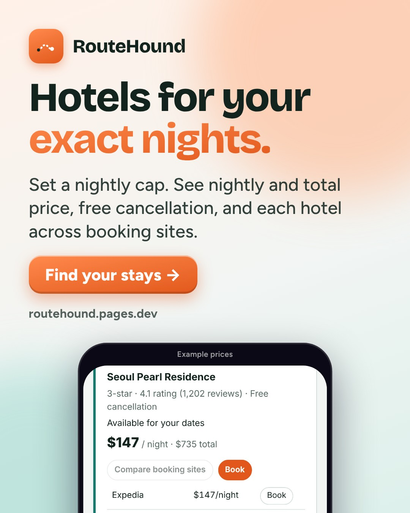
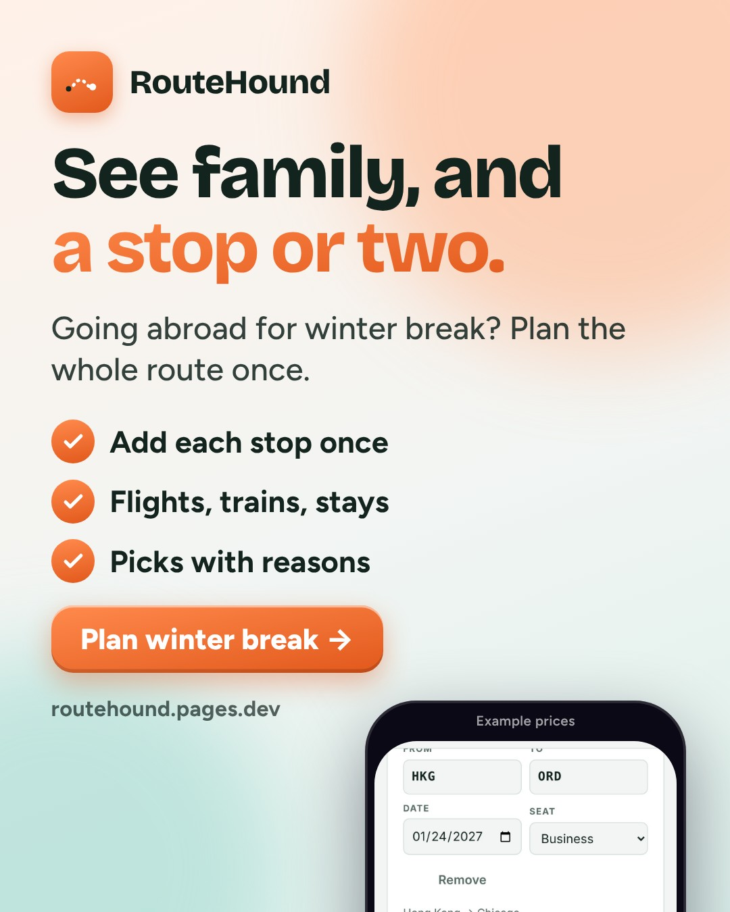
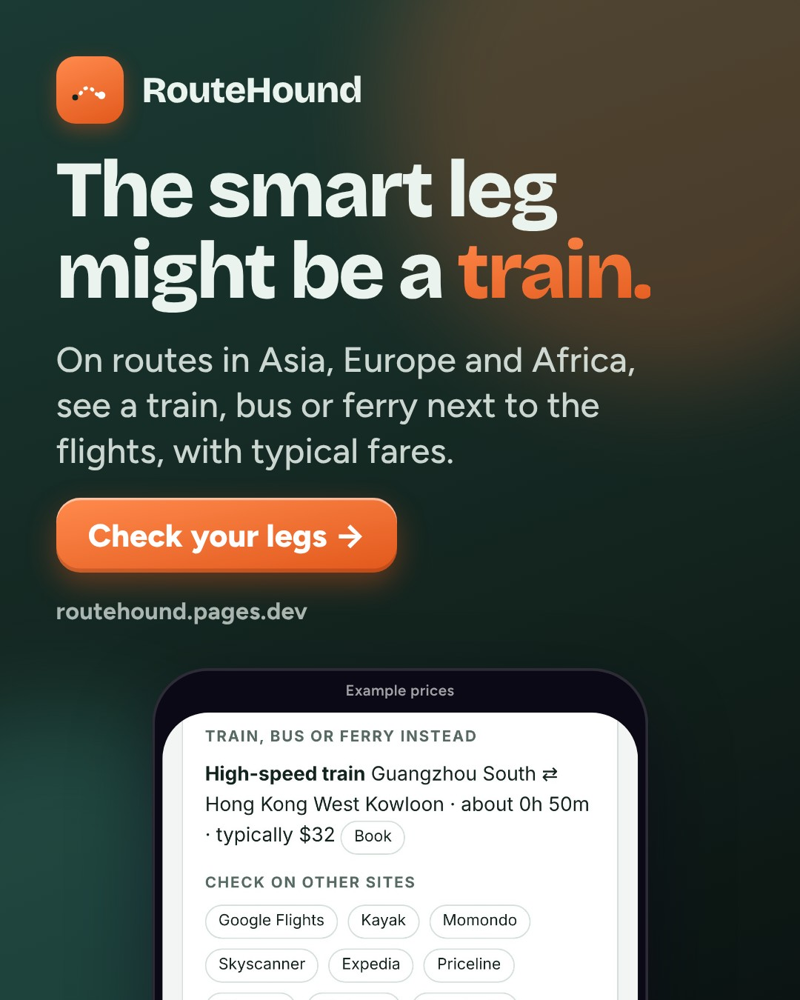
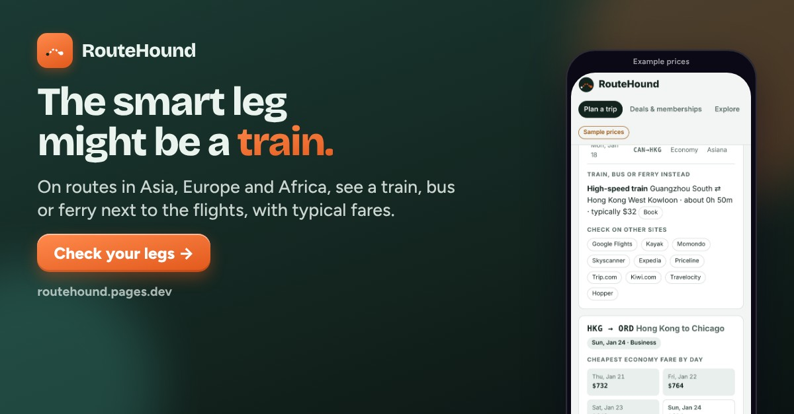
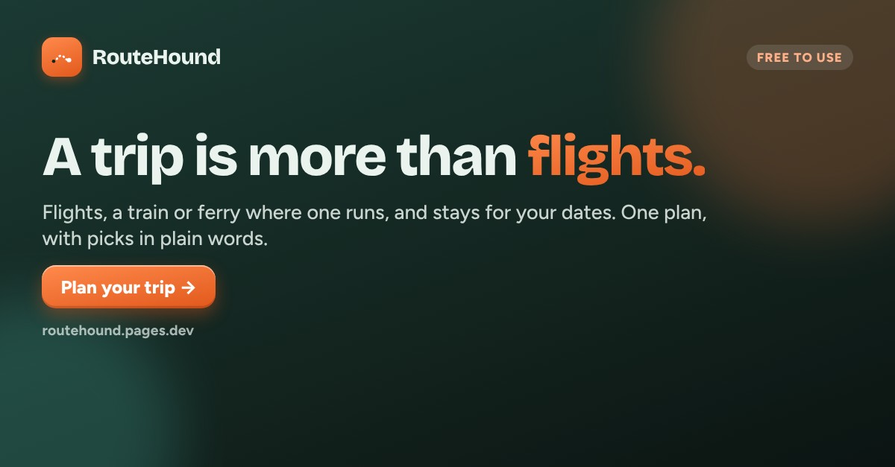
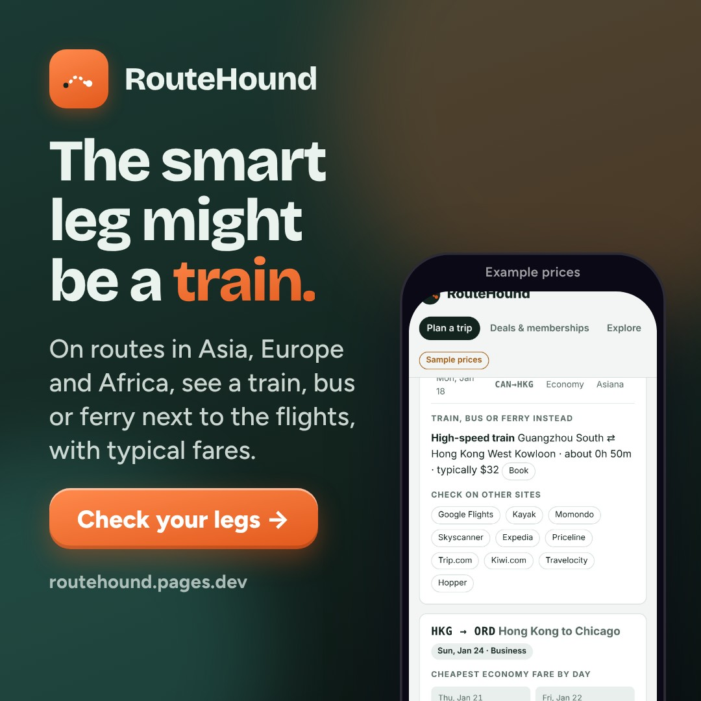

# RouteHound · week of 2026-11-16 · Beyond flights: trains, ferries and stays in one plan

**Approve by merging this pull request.** Facebook and Instagram posts then go out at their times. Everything else is a ready-to-paste draft.
To change something, edit `marketing/campaigns/2026-11-16.json` and rebuild, or set `"skip": true` on a post. Delete a post to drop it.

**Goal:** Trip searches from social and community links (UTM-tagged per post); learn whether the ground-options angle (train-instead) or the stays angle (stays-your-dates) gets more clicks.
**Why this angle:** No results yet (last week's branch was not merged and there is no marketing/results.md), so this week tests two new lead features instead of repeating last week's 'whole trip' and 'shift a day' angles. Both ship today: each leg has a 'Train, bus or ferry instead' card with typical fares and times on 30+ corridors (engine.js GROUND), and 'Where to stay' shows available stays for the exact dates under a nightly cap, with free cancellation flagged and each hotel compared across booking sites. Thanksgiving is Nov 26 and winter-break trips to see family abroad are being planned now; the example trip (Chicago, Seoul, Guangzhou, Hong Kong) includes the Guangzhou-Hong Kong high-speed train.

## facebook · Mon, Nov 16, 7:00 PM · auto after approval


```text
A trip isn't just flights. Between cities there's often a train or a ferry, and every night you need a place to sleep.

RouteHound puts all of it in one plan: flights for each leg, a train, bus or ferry option where one exists, and stays for your exact dates. Then it tells you which way makes the most sense, in plain words.

Free to use. https://routehound.pages.dev/?utm_source=facebook&utm_medium=social&utm_campaign=2026-11-16-beyond-flights-trains-ferries&utm_content=fb-beyond
```

_Posts automatically at the time shown after this is approved (merged)._

## facebook · Wed, Nov 18, 12:00 PM · auto after approval



```text
Set a nightly cap once, and RouteHound shows stays that are available for the exact nights of each stop, with the nightly and total price and whether cancellation is free.

You can also see each hotel's price on different booking sites before you pick one.

Try it on the example trip: https://routehound.pages.dev/?utm_source=facebook&utm_medium=social&utm_campaign=2026-11-16-beyond-flights-trains-ferries&utm_content=fb-stays

(Some booking links are affiliate links. They don't change your price.)
```

_Posts automatically at the time shown after this is approved (merged)._

## facebook · Fri, Nov 20, 7:30 PM · auto after approval



```text
Seeing family over winter break, with a stop or two along the way?

Add every city and date once. RouteHound checks the flights, any train or ferry between stops, and places to stay, then gives you a few picks with the reason for each.

Prices change fast this time of year, so the booking site's price is always the final one. https://routehound.pages.dev/?utm_source=facebook&utm_medium=social&utm_campaign=2026-11-16-beyond-flights-trains-ferries&utm_content=fb-holiday
```

_Posts automatically at the time shown after this is approved (merged)._

## instagram · Tue, Nov 17, 7:00 PM · auto after approval



```text
Sometimes the smart leg isn't a flight.

For each leg, RouteHound shows a train, bus or ferry instead where one runs: Guangzhou to Hong Kong by high-speed train, London to Paris on the Eurostar, Athens to the islands by ferry. Typical fares and times, labeled as estimates.

Link in bio.

#traintravel #budgettravel #slowtravel #interrail #backpacking #travelplanning
```

_Posts automatically at the time shown after this is approved (merged)._

## instagram · Thu, Nov 19, 7:30 PM · auto after approval


```text
Your flights and your stays, in the same plan.

Pick a nightly cap and RouteHound shows places available on the exact nights of each stop, with total price and free cancellation flagged. Compare one hotel across booking sites in a tap.

Free to use. Link in bio.

#hotels #budgettravel #travelplanning #multicitytrip #traveltips
```

_Posts automatically at the time shown after this is approved (merged)._

## instagram · Sat, Nov 21, 12:00 PM · auto after approval


```text
Winter break, visiting family, a couple of stops on the way? Plan it once: flights, trains or ferries between stops, and stays, with a plain reason for every pick.

Link in bio.

#wintertravel #holidaytravel #familytravel #travelplanning #budgettravel
```

_Posts automatically at the time shown after this is approved (merged)._

## linkedin · Tue, Nov 17, 12:00 PM · post by hand



```text
A lesson from building RouteHound, my multi-city trip planner: the honest answer is sometimes "don't fly this leg."

Flight APIs only know about flights. But Guangzhou to Hong Kong, Seoul to Busan or Rome to Florence are often better by train, and some islands are better by ferry. So I added a small table of 30+ train, bus and ferry corridors with typical fares and times, and RouteHound shows them next to the flights for that leg.

The design choice I care about most: those fares are labeled "typical fare", not shown as live prices. Same with the demo: without live price sources, every number says it's an example. Being clear about what's live and what's an estimate matters more than looking complete.

The plan now covers flights, ground options and stays for your exact dates. If you're planning a winter trip with more than one stop, I'd value your feedback: https://routehound.pages.dev/?utm_source=linkedin&utm_medium=community&utm_campaign=2026-11-16-beyond-flights-trains-ferries&utm_content=li-ground
```

_Post by hand from your profile or the company page: paste the text, attach the image._

## reddit · Wed, Nov 18, 12:30 PM · post by hand

**Where:** r/SideProject (check the sidebar rules before posting; rules could not be verified automatically)

**Title:** I built a trip planner that treats trains, ferries and hotels as part of the route, not an afterthought



```text
I made RouteHound, a free planner for multi-city trips. You add every leg once, and for each leg it shows flights, plus a train, bus or ferry option where one exists (30+ corridors in Asia, Europe and Africa so far), plus stays for the exact nights of each stop under a nightly cap. Then it gives a few picks for the whole trip with a short reason for each.

Things I'd like feedback on:
- Ground options use typical fares and times and are labeled that way, not as live prices. Is that clear enough on the leg cards?
- The stays section compares each hotel across booking sites. Useful, or too much on one page?
- Which train or ferry routes should I add next?

There's an example trip (Chicago, Seoul, Guangzhou, Hong Kong) if you don't want to type your own. If the site isn't connected to live sources, numbers are labeled as examples.

Disclosure: I built it, and booking links are affiliate links (they don't change your price). https://routehound.pages.dev/?utm_source=reddit&utm_medium=community&utm_campaign=2026-11-16-beyond-flights-trains-ferries&utm_content=rd-sideproject
```

_Post by hand. Read the subreddit rules first, post as yourself, reply to every comment, and don’t post the same thing to several subreddits._

## tiktok · Thu, Nov 19, 6:30 PM · post by hand

```text
Not every leg should be a flight. Here's how I check for a train or ferry first. #traintravel #traveltok #budgettravel #travelhacks #backpacking
```

**Script:**

1. 0-2s: hook on screen: "Stop booking a flight for every leg" over the RouteHound plan screen
2. 2-5s: tap Load example trip (Chicago, Seoul, Guangzhou, Hong Kong), then Sniff out prices
3. 5-10s: scroll to Every leg, compared and stop on the Guangzhou to Hong Kong leg's 'Train, bus or ferry instead' card
4. 10-13s: scroll to Where to stay to show stays for the same dates
5. 13-15s: takeaway on screen: "Check the train before you fly the short hop." End card: free to use, link in bio. Small label: example prices, typical fares

_Post by hand from the TikTok app: use the video (or record the script), paste the caption._

## tiktok · Sun, Nov 22, 7:00 PM · post by hand

```text
Plan the hotels with the flights, not after. #hotels #traveltok #travelplanning #holidaytravel #budgettravel
```

**Script:**

1. 0-2s: hook on screen: "Your flights are booked. Now 4 cities of hotels?" over the stays screen
2. 2-5s: set the nightly cap field on the plan screen, tap Sniff out prices
3. 5-10s: scroll Where to stay: nightly and total price, free cancellation
4. 10-13s: open one hotel's price across booking sites
5. 13-15s: takeaway: "Same plan, same dates, flights and stays together." End card: free to use, link in bio. Small label: example prices

_Post by hand from the TikTok app: use the video (or record the script), paste the caption._

## group · Fri, Nov 20, 12:00 PM · post by hand

**Where:** A budget-travel or backpacking Facebook group whose rules allow sharing free tools (ask the admin first; don't post if they say no)



```text
Hi all. Before I post this I checked with the admin, since I made the tool.

I built a free planner for multi-city trips that looks past flights. For each leg it shows a train, bus or ferry option where one runs (things like Guangzhou to Hong Kong by high-speed train, Seoul to Busan on the KTX, Athens to the islands by ferry), next to the flights, and it finds stays for your exact nights under a nightly cap. Train and ferry fares are typical fares, labeled as estimates.

Disclosure: I made it, and some booking links are affiliate links (no change to your price). I'd really like to know which train or ferry routes you'd want added: https://routehound.pages.dev/?utm_source=group&utm_medium=community&utm_campaign=2026-11-16-beyond-flights-trains-ferries&utm_content=grp-ground
```

_Ask the group admin first, then post as yourself. Never in groups that ban promotion._

## Videos (Reels, TikTok, Shorts)

- [video/train-tour.mp4](video/train-tour.mp4)
- [video/stays-tour.mp4](video/stays-tour.mp4)
