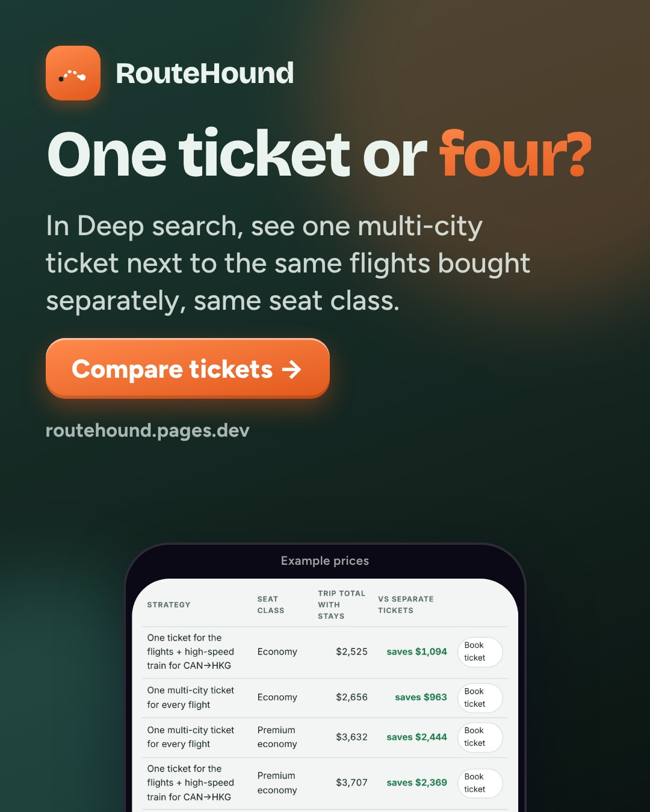
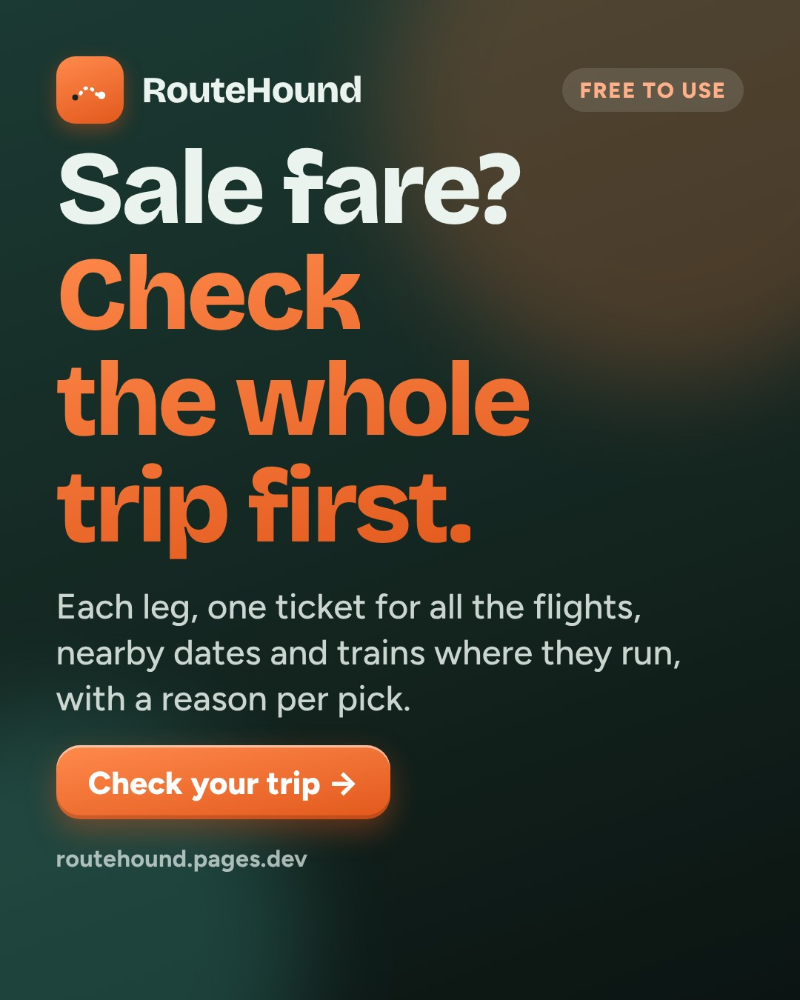
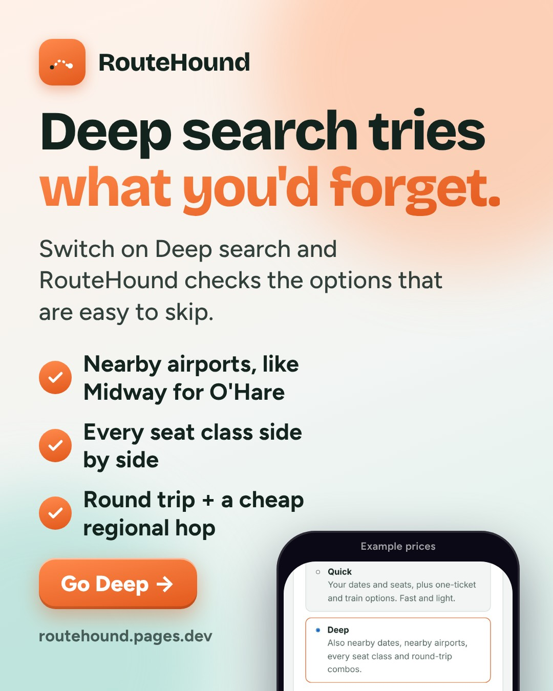
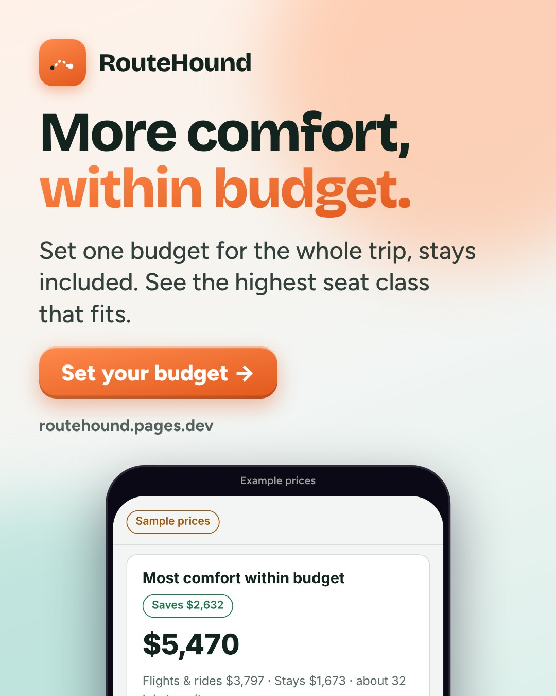
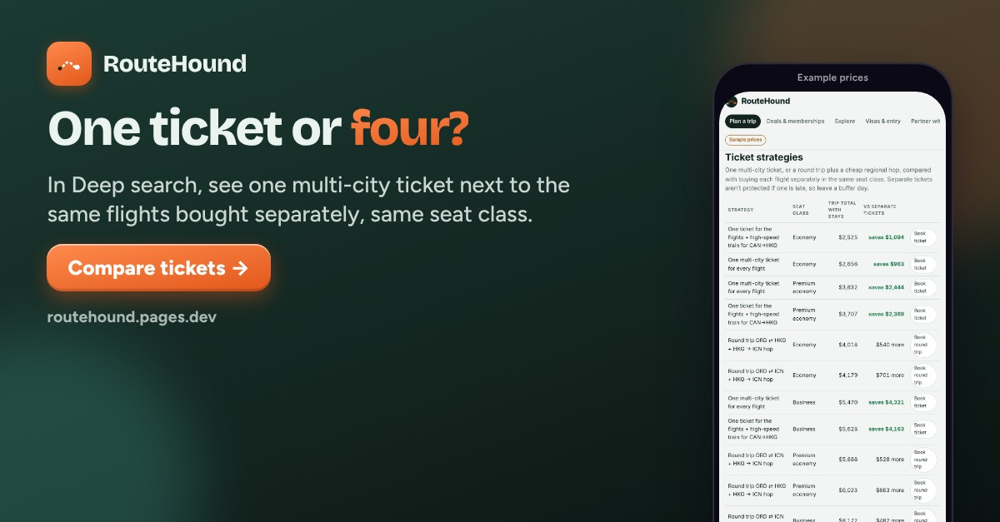

# RouteHound · week of 2026-11-23 · One ticket or four? How you book the trip matters

**Approve by merging this pull request.** Facebook and Instagram posts then go out at their times. Everything else is a ready-to-paste draft.
To change something, edit `marketing/campaigns/2026-11-23.json` and rebuild, or set `"skip": true` on a post. Delete a post to drop it.

**Goal:** Trip searches from social and community links (UTM-tagged per post), and which lead angle gets more clicks: ticket strategies (one-ticket) or seat class within budget (comfort-budget).
**Why this angle:** No results yet (the 11-09 and 11-16 branches were not merged and there is no marketing/results.md), so this week tests features the last two weeks never led with. Both ship today: 'Ticket strategies' compares one multi-city ticket (and, in Deep search, a round trip plus a cheap regional hop) with buying the same flights separately in the same seat class, with a plain warning to leave a buffer day on separate tickets; Smart picks include 'Most comfort within budget', which finds the highest seat class that keeps the whole trip under your budget; Deep search also tries nearby airports (Midway for O'Hare, Gimpo for Incheon, Shenzhen or Macau for Hong Kong). Black Friday (Nov 27) and Cyber Monday (Nov 30) fare sales are when people book winter and spring trips, often one leg at a time, so the honest timely message is: before you grab a sale fare for one leg, see how the whole trip prices as one ticket. No savings figures; every price shown is labeled as an example.

## facebook · Mon, Nov 23, 7:00 PM · auto after approval



```text
Booking a trip with three or four flights? How you buy them can change the total.

Turn on Deep search and RouteHound's Ticket strategies table puts one multi-city ticket for the whole trip next to the same flights bought separately, in the same seat class, so you can see which comes out lower for your dates. Sometimes it's the single ticket, sometimes it isn't.

One honest note it shows too: separate tickets aren't protected if one flight is late, so leave a buffer day.

Free to use. Try it on the example trip: https://routehound.pages.dev/?utm_source=facebook&utm_medium=social&utm_campaign=2026-11-23-one-ticket-or-four-how-you-bo&utm_content=fb-oneticket

(Some booking links are affiliate links. They don't change your price or the order of results.)
```

_Posts automatically at the time shown after this is approved (merged)._

## facebook · Fri, Nov 27, 12:00 PM · auto after approval



```text
Seeing Black Friday fare sales for a trip with more than one stop?

Before you book one leg, add the whole route to RouteHound. It checks each leg, one multi-city ticket for all the flights, nearby dates, and a train or ferry where one runs, and tells you in plain words which way makes the most sense.

Sale prices change fast, so the booking site's price is always the final one. https://routehound.pages.dev/?utm_source=facebook&utm_medium=social&utm_campaign=2026-11-23-one-ticket-or-four-how-you-bo&utm_content=fb-sale
```

_Posts automatically at the time shown after this is approved (merged)._

## facebook · Sun, Nov 29, 7:00 PM · auto after approval



```text
Three things RouteHound's Deep search tries that are easy to forget when you book by hand:

1. Nearby airports: Midway instead of O'Hare, Gimpo instead of Incheon, Shenzhen or Macau instead of Hong Kong.
2. Every seat class side by side, plus the highest class that fits your budget.
3. A round trip to one city plus a cheap regional hop, compared with separate one-ways.

It's free to use, and every pick says what it changed from your plan. Planning ahead of Cyber Monday? https://routehound.pages.dev/?utm_source=facebook&utm_medium=social&utm_campaign=2026-11-23-one-ticket-or-four-how-you-bo&utm_content=fb-deep
```

_Posts automatically at the time shown after this is approved (merged)._

## instagram · Tue, Nov 24, 7:00 PM · auto after approval


```text
One ticket or four?

For a multi-city trip, switch on Deep search and RouteHound compares one multi-city ticket with the same flights bought separately, same seat class, same dates. You see both totals side by side before you book. Prices in the demo are labeled as examples.

Tip it shows too: separate tickets aren't protected if one flight runs late, so leave a buffer day.

Free to use. Link in bio.

#multicitytrip #travelhacks #budgettravel #cheapflights #travelplanning #traveltips
```

_Posts automatically at the time shown after this is approved (merged)._

## instagram · Wed, Nov 25, 12:00 PM · auto after approval



```text
Want more comfort on a big trip without blowing the budget?

Set one budget for the whole trip, stays included, and RouteHound's 'Most comfort within budget' pick finds the highest seat class that still keeps the trip under it, with a plain reason. Prices in the demo are labeled as examples.

Link in bio.

#businessclass #travelhacks #budgettravel #longhaul #travelplanning #multicitytrip
```

_Posts automatically at the time shown after this is approved (merged)._

## instagram · Sat, Nov 28, 11:00 AM · auto after approval


```text
Fare sale weekend. Before you book one leg, check the whole trip.

Add every city and date to RouteHound: it compares each leg, one ticket for all the flights, nearby dates, and trains or ferries where they run, with a plain reason for each pick. The booking site's price is always the final one.

Link in bio.

#blackfriday #cybermonday #travelplanning #budgettravel #cheapflights #wintertravel
```

_Posts automatically at the time shown after this is approved (merged)._

## linkedin · Tue, Nov 24, 12:00 PM · post by hand



```text
A lesson from building RouteHound, my multi-city trip planner: a route is not the same thing as a set of tickets.

My first version found the cheapest flight on each leg and added them up. That misses how airlines actually price trips: the same four flights can cost a different amount as one multi-city ticket than as four separate ones, and a round trip to one city plus a short regional hop can differ again.

So RouteHound now searches the whole trip as one ticket too, and in Deep search shows a Ticket strategies table: each way of buying the trip, in the same seat class, next to buying every flight separately. Sometimes separate wins. The table just shows both.

The part I almost left out: separate tickets aren't protected if one flight is late. A tool that only shows the lower number would hide that, so the table says it plainly and suggests a buffer day. Showing the trade-off matters more than showing a bigger difference.

If you're booking a winter or spring trip with more than one stop during this week's sales, I'd value your feedback: https://routehound.pages.dev/?utm_source=linkedin&utm_medium=community&utm_campaign=2026-11-23-one-ticket-or-four-how-you-bo&utm_content=li-tickets
```

_Post by hand from your profile or the company page: paste the text, attach the image._

## reddit · Tue, Nov 24, 7:30 PM · post by hand

**Where:** r/alphaandbetausers (a sub for getting early users and feedback; read the sidebar rules before posting, they could not be checked automatically. Post once, as yourself, and reply to every comment)

**Title:** [Web] I built a free multi-city trip planner that compares one multi-city ticket with buying each flight separately. Looking for feedback


```text
Hi all. I made RouteHound, a free web app for trips with more than one stop. You add every leg once, and it compares ways to book the whole trip (turn on Deep search for the full comparison): one multi-city ticket for all the flights versus each flight bought separately in the same seat class (and in Deep search, a round trip to one city plus a cheap regional hop). It also shows per-leg fares by day, trains or ferries where they run, and stays for your exact nights, then gives a few picks with a plain reason for each.

What I'd love feedback on:
- Is the Ticket strategies table easy to read, or does it need a one-line summary on top?
- It warns that separate tickets aren't protected if a flight is late and suggests a buffer day. Is that enough, or should it be louder?
- The 'Most comfort within budget' pick shows the highest seat class that keeps the whole trip under your budget. Useful, or confusing?

There's an example trip (Chicago, Seoul, Guangzhou, Hong Kong) if you don't want to type your own. When the site isn't connected to live price sources, every number is labeled as an example.

Disclosure: I built it, and booking links are affiliate links (they don't change your price or the order of results). https://routehound.pages.dev/?utm_source=reddit&utm_medium=community&utm_campaign=2026-11-23-one-ticket-or-four-how-you-bo&utm_content=rd-alphabeta
```

_Post by hand. Read the subreddit rules first, post as yourself, reply to every comment, and don’t post the same thing to several subreddits._

## tiktok · Wed, Nov 25, 6:30 PM · post by hand

```text
One ticket or four? Check before you book a multi-city trip. Example prices in the video. #traveltok #travelhacks #multicitytrip #budgettravel #cheapflights
```

**Script:**

1. 0-2s: hook on screen: "Booking 4 flights separately? Check this first" over the RouteHound plan screen
2. 2-5s: tap Load example trip (Chicago, Seoul, Guangzhou, Hong Kong), switch to Deep search, then Sniff out prices
3. 5-10s: scroll to Ticket strategies and hold on the row 'One multi-city ticket for every flight' next to the 'vs separate tickets' column
4. 10-13s: zoom on the note under the heading: separate tickets aren't protected if one is late, leave a buffer day
5. 13-15s: takeaway on screen: "Price the whole trip as one ticket before you buy legs one by one." End card: free to use, link in bio. Small label: example prices

_Post by hand from the TikTok app: use the video (or record the script), paste the caption._

## tiktok · Sat, Nov 28, 6:00 PM · post by hand

```text
How much comfort fits your trip budget? Set it once and see. Example prices in the video. #businessclass #traveltok #travelhacks #budgettravel #longhaul
```

**Script:**

1. 0-2s: hook on screen: "How much comfort does your budget buy?" over the plan screen with the budget field
2. 2-5s: load the example trip, show the 'Trip budget per person' field (example: 6500), tap Sniff out prices
3. 5-10s: scroll to Smart picks and stop on the 'Most comfort within budget' card; open 'See the full plan' to show the seat class it picked
4. 10-13s: point at the line under the total (flights and rides, stays, hours in transit)
5. 13-15s: takeaway on screen: "Set the budget once, see the comfiest plan that fits." End card: free to use, link in bio. Small label: example prices

_Post by hand from the TikTok app: use the video (or record the script), paste the caption._

## group · Sun, Nov 29, 12:00 PM · post by hand

**Where:** A budget-travel or backpacking Facebook group whose rules allow sharing free tools (message the admin first and ask; don't post if they say no or the rules ban promotion)

```text
Hi all. I asked the admin before posting this, since I made the tool.

A tip for anyone booking a multi-city trip in the sales this week: price the whole trip as one multi-city ticket before you buy legs one at a time. Sometimes one ticket comes out lower, sometimes separate tickets do. If you go separate, leave a buffer day between flights, because a missed connection on separate tickets usually isn't covered.

I built a free planner, RouteHound, that does that comparison for you in its Deep search mode: one ticket versus separate tickets in the same seat class, plus fares by day, trains or ferries where they run, and stays for your dates. Prices are labeled as examples when it isn't connected to live data, and some booking links are affiliate links (they don't change your price).

Happy to answer questions about booking multi-city trips either way. https://routehound.pages.dev/?utm_source=group&utm_medium=community&utm_campaign=2026-11-23-one-ticket-or-four-how-you-bo&utm_content=grp-tickets
```

_Ask the group admin first, then post as yourself. Never in groups that ban promotion._

## Videos (Reels, TikTok, Shorts)

- [video/ticket-tour.mp4](video/ticket-tour.mp4)
- [video/comfort-tour.mp4](video/comfort-tour.mp4)
