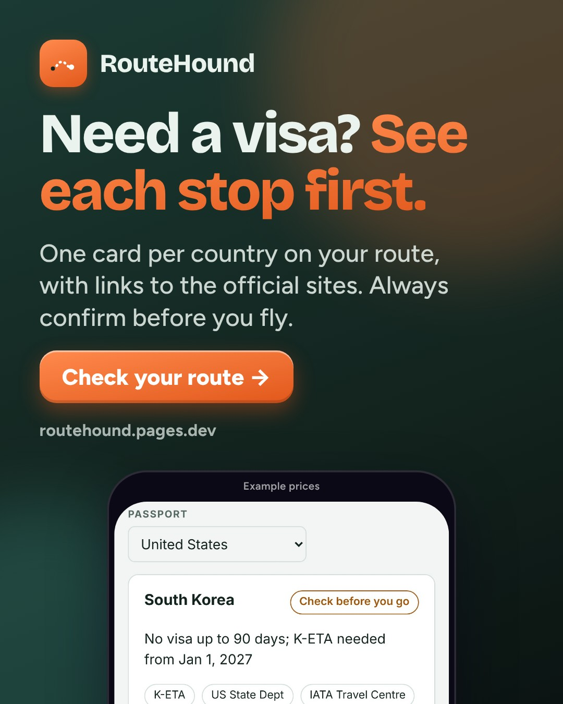
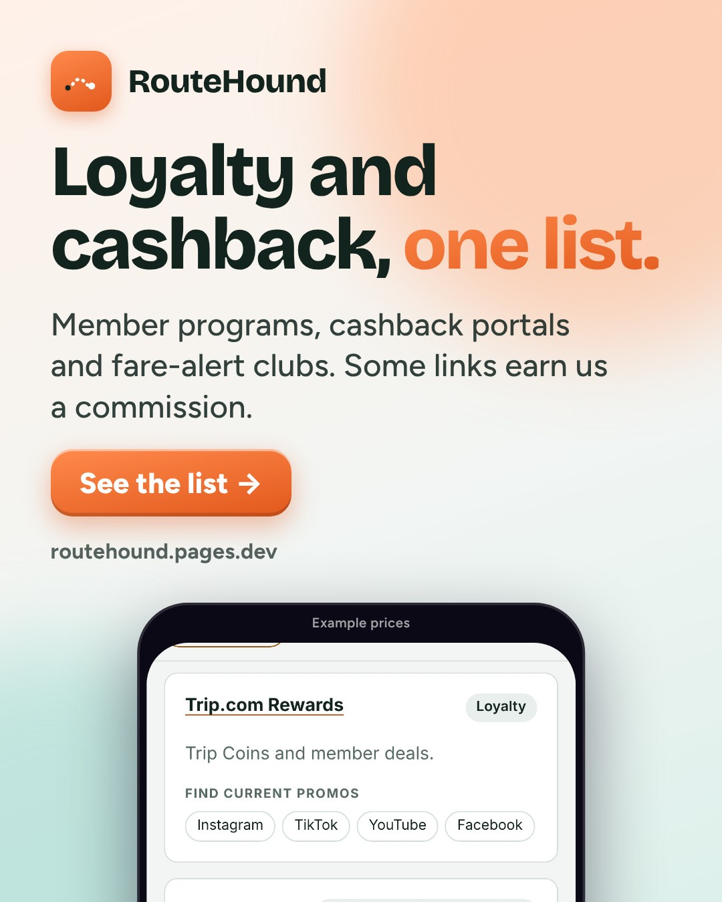
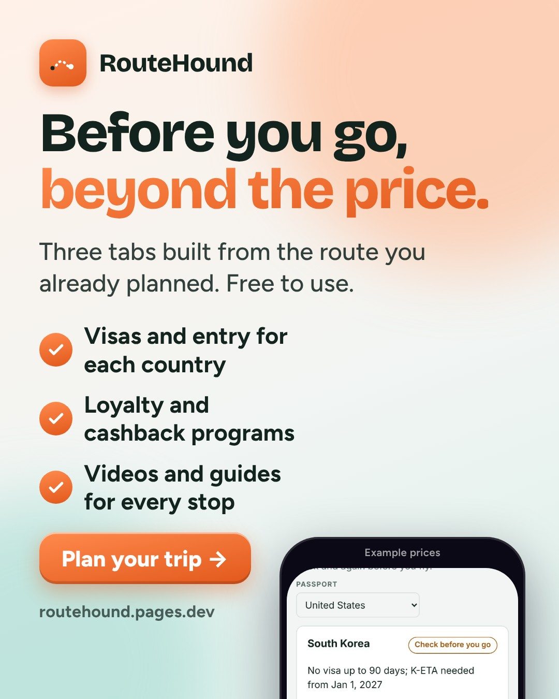
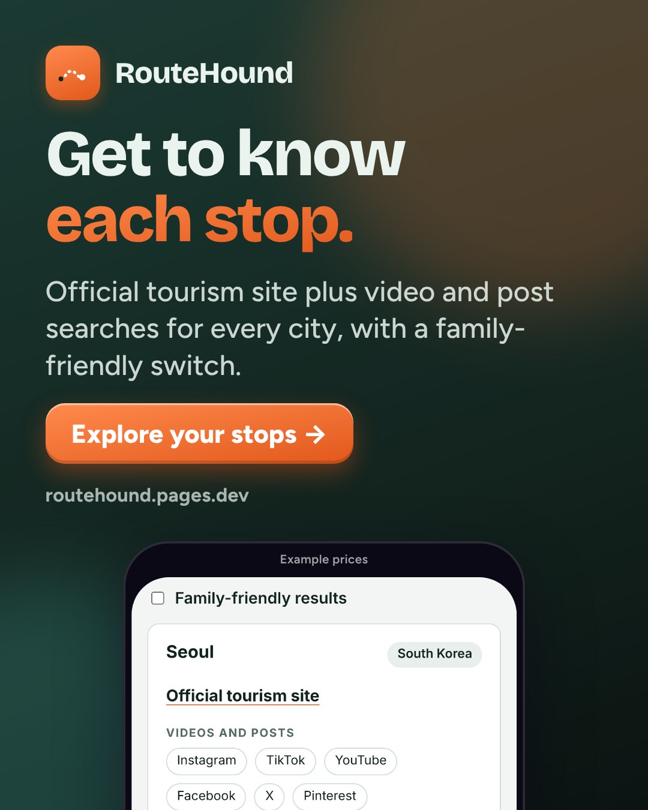
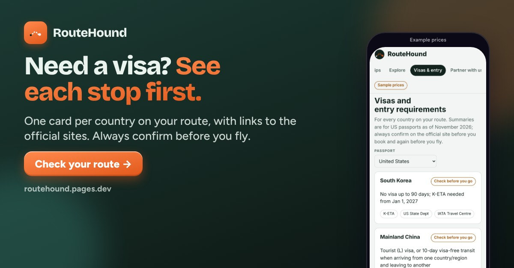
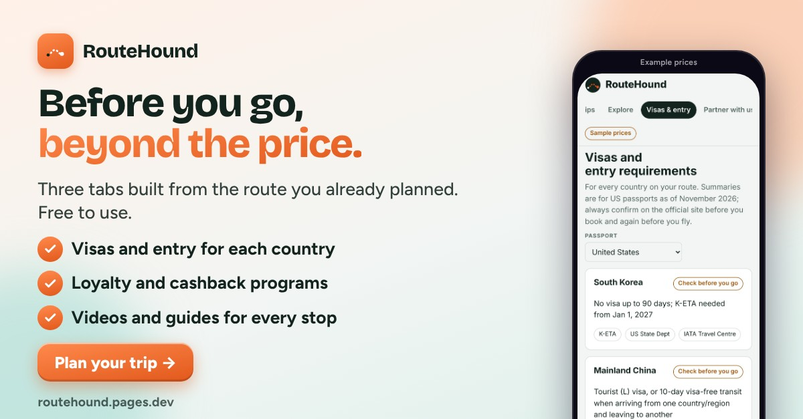

# RouteHound · week of 2026-11-30 · Before you go: visas, perks and your stops

**Approve by merging this pull request.** Facebook and Instagram posts then go out at their times. Everything else is a ready-to-paste draft.
To change something, edit `marketing/campaigns/2026-11-30.json` and rebuild, or set `"skip": true` on a post. Delete a post to drop it.

**Goal:** Clicks from UTM-tagged social and community links (by utm_content per post), and which landing tab pulls more of them: Visas & entry (posts linking to /#entry, angle entry-check: fb-entry, li-entry, grp-entry) or Deals & memberships (fb-perks linking to /#deals, angle perks). Instagram and TikTok go through the bio link, so they're compared by utm_source only.
**Why this angle:** No results yet: the 11-09, 11-16 and 11-23 branches are unmerged, nothing has been posted, and there is no marketing/results.md, so this week tests a new angle instead of building on data. Three weeks led with price (whole trip, trains and stays, ticket strategies). None led with the three tabs that cover everything except the fare, and all three work without API keys. Visas & entry gives one card per country on the route: a dated summary for US passports, a 'Check before you go' or 'Nothing to apply for' tag, and links to the official site, the US State Dept and IATA. Other passports get the official links. Deals & memberships lists loyalty programs, cashback portals and fare-alert clubs, each with promo-code searches. Explore gives each stop its official tourism site, video and post searches on six platforms, and a family-friendly switch. Timing: Cyber Monday (Nov 30) is when winter-break and spring trips get booked. For the example route (Seoul, Guangzhou, Hong Kong in January 2027), the app's South Korea card notes K-ETA is needed from Jan 1, 2027, which is a real before-you-go check. Visa info is always framed the way the app frames it: a starting point to confirm on official sites. No savings figures. Any price shown is labeled as an example.

## facebook · Mon, Nov 30, 7:00 PM · auto after approval



```text
Booking a winter-break or spring trip in the Cyber Monday sales? Before you pay for the flights, check what each country on the route asks of you at the border.

RouteHound's Visas & entry tab makes one card for every country on your trip, with a short summary for US passports (dated, so you know how fresh it is), a 'Check before you go' or 'Nothing to apply for' tag, and links to the official site, the US State Department and IATA's travel centre. Other passports get the official links.

It's a starting point, not the final word: always confirm on the official site before you book and again before you fly.

Free to use. Add your route, search, then open Visas & entry: https://routehound.pages.dev/?utm_source=facebook&utm_medium=social&utm_campaign=2026-11-30-before-you-go-visas-perks-and&utm_content=fb-entry#entry
```

_Posts automatically at the time shown after this is approved (merged)._

## facebook · Wed, Dec 2, 12:00 PM · auto after approval



```text
Found the trip? Before you book, see which loyalty program, cashback portal or member discount you could stack on it.

RouteHound's Deals & memberships tab puts them in one list: hotel and booking-site loyalty programs, cashback portals, fare-alert clubs, and member travel desks like AAA and Costco Travel. Each one has a one-line note and quick searches for current promo codes.

Free to use: https://routehound.pages.dev/?utm_source=facebook&utm_medium=social&utm_campaign=2026-11-30-before-you-go-visas-perks-and&utm_content=fb-perks#deals

(Some links in RouteHound are affiliate links. They don't change your price or the order of results.)
```

_Posts automatically at the time shown after this is approved (merged)._

## facebook · Fri, Dec 4, 7:00 PM · auto after approval



```text
Three things to check before a trip with several stops, besides the fare:

1. Entry rules for every country. Some need an online authorization or an arrival form even when you don't need a visa.
2. Loyalty and cashback programs you could stack on the booking.
3. What each stop is like: the official tourism site, plus videos and posts from travelers.

RouteHound has a tab for each: Visas & entry, Deals & memberships and Explore, built from the route you've already planned. Entry summaries are a starting point, so confirm on the official sites.

Free to use: https://routehound.pages.dev/?utm_source=facebook&utm_medium=social&utm_campaign=2026-11-30-before-you-go-visas-perks-and&utm_content=fb-before

(Some links are affiliate links; they never change your price or the order of results.)
```

_Posts automatically at the time shown after this is approved (merged)._

## instagram · Tue, Dec 1, 7:00 PM · auto after approval


```text
Visa, e-visa, travel authorization, arrival form? It depends on the country, and a multi-country trip can need a different one at each stop.

Plan your route in RouteHound, then open Visas & entry: one card per country with a short summary for US passports and links to the official sites. Other passports get the official links. Treat it as your checklist and confirm each one on the official site before you book.

Free to use. Link in bio.

#travelchecklist #visatips #wintertravel #multicitytrip #budgettravel #travelplanning #traveltips
```

_Posts automatically at the time shown after this is approved (merged)._

## instagram · Thu, Dec 3, 7:00 PM · auto after approval


```text
The fare is one part. The program you book through is another.

RouteHound's Deals & memberships tab lists loyalty programs, cashback portals and fare-alert clubs in one place, with a one-line note on each and quick links to search for current promo codes. Look through it before you book.

Free to use. Link in bio. Some links are affiliate links; they don't change your price.

#travelhacks #cashback #loyaltyprogram #budgettravel #travelplanning #pointsandmiles
```

_Posts automatically at the time shown after this is approved (merged)._

## instagram · Sat, Dec 5, 11:00 AM · auto after approval



```text
Booked Seoul, Guangzhou and Hong Kong? Now get to know them.

RouteHound's Explore tab makes a card for each stop on your route: the official tourism site where there is one, quick searches for videos and posts on YouTube, TikTok, Instagram, Pinterest and more, and shortcuts for hidden gems, street food, on a budget and getting around. Flip on family-friendly results if the kids are coming.

Free to use. Link in bio.

#travelinspo #multicitytrip #familytravel #asiatravel #travelplanning #budgettravel
```

_Posts automatically at the time shown after this is approved (merged)._

## linkedin · Tue, Dec 1, 12:00 PM · post by hand



```text
A lesson from building RouteHound, my multi-city trip planner: the most useful thing for a traveler isn't always a price.

I nearly left out the Visas & entry tab. Entry rules change, and a confident, out-of-date answer is worse than no answer. But people planning a trip through three or four countries were asking the same thing: what do I need for each stop?

So I built it around honesty instead of completeness:
- Every summary is dated and says who it's for (US passports for now). Other passports get the official links, not a guess.
- Each country gets a plain tag, 'Check before you go' or 'Nothing to apply for', and links to the official site, the US State Department and IATA's travel centre.
- The page says it outright: confirm on the official site before you book and again before you fly.

One example from the sample route: for US passports, the South Korea card says K-ETA is needed from Jan 1, 2027. For anyone planning a winter-break trip through Seoul in January, that's worth knowing before the trip, not at the airport.

The broader lesson for me: when your data can go stale, show the date, show the source, and send people to the authority. Trust comes from that.

If you're planning a trip across several countries this winter or spring, I'd value your feedback: https://routehound.pages.dev/?utm_source=linkedin&utm_medium=community&utm_campaign=2026-11-30-before-you-go-visas-perks-and&utm_content=li-entry#entry
```

_Post by hand from your profile or the company page: paste the text, attach the image._

## reddit · Wed, Dec 2, 7:30 PM · post by hand

**Where:** r/IMadeThis (self-promotion sub where makers share software; verify rules before posting: the rules page could not be opened automatically, so read the sidebar and any flair or link rules first. Post once, as yourself, reply to every comment)

**Title:** I made a free trip planner for multi-country trips, and added a 'before you go' side: visas and entry per country, loyalty/cashback programs, and a page per stop



```text
I made RouteHound, a free web app for trips with several stops. You add every leg once and it prices the whole trip (flights, trains or ferries where they run, and stays), then gives a few picks with a plain reason for each.

This week I'm looking for feedback on the parts that aren't about price:

- Visas & entry: one card per country on your route. For US passports there's a short dated summary and a 'Check before you go' or 'Nothing to apply for' tag. Every card links to the official site, the US State Dept and IATA's travel centre. Other passports get the links only, because I'd rather not guess.
- Deals & memberships: loyalty programs, cashback portals and fare-alert clubs in one list, with quick promo-code searches.
- Explore: for each stop, the official tourism site plus quick searches for videos and posts, with a family-friendly switch.

Questions I'd love answers to:
1. Is 'confirm on the official site' clear enough on the entry cards, or should it be louder?
2. Would summaries for other passports be worth it, given they go stale?
3. Is a deals list useful, or just noise next to the trip itself?

There's an example trip (Chicago, Seoul, Guangzhou, Hong Kong) if you don't want to type your own. When it isn't connected to live price sources, every price is labeled as an example.

Disclosure: I built this, and outbound booking and deal links can be affiliate links (they don't change your price or the order of results). https://routehound.pages.dev/?utm_source=reddit&utm_medium=community&utm_campaign=2026-11-30-before-you-go-visas-perks-and&utm_content=rd-imadethis
```

_Post by hand. Read the subreddit rules first, post as yourself, reply to every comment, and don’t post the same thing to several subreddits._

## tiktok · Wed, Dec 2, 6:30 PM · post by hand

```text
Multi-country trip? Check entry rules for every stop before you book. Summaries are a starting point; always confirm on the official site. Example trip and prices in the video. #traveltok #travelchecklist #visatips #wintertravel #multicitytrip #budgettravel
```

**Script:**

1. Video: entry-tour (ad-maker render). 0-2s: hook on screen: "3 countries, 3 different entry rules" over the entry-check intro card
2. 2-5s: screen recording: tap Load example trip (Chicago, Seoul, Guangzhou, Hong Kong) and show the route form (skip the price results; no savings figures on screen)
3. 6-11s: tap the Visas & entry tab. Hold on the header line 'always confirm on the official site before you book and again before you fly', then the South Korea card ('K-ETA needed from Jan 1, 2027', tag 'Check before you go')
4. 11-15s: scroll to Mainland China (visa or visa-free transit, 'Check before you go') and Hong Kong ('Nothing to apply for'). Point at the official-site, US State Dept and IATA chips
5. 15-17s: takeaway on screen: "Check each country before you book, then confirm on the official site." End card: free to use, link in bio

_Post by hand from the TikTok app: use the video (or record the script), paste the caption._

## tiktok · Sat, Dec 5, 6:00 PM · post by hand

```text
Three tabs I check after the flights are sorted: entry rules, loyalty and cashback, and the stops themselves. Some links are affiliate links. #traveltok #travelhacks #travelchecklist #budgettravel #multicitytrip #travelplanning
```

**Script:**

1. Video: before-tour (ad-maker render). 0-2s: hook on screen: "Flights booked? Check these 3 things" over the before-you-go intro card
2. 2-6s: screen recording: tap Visas & entry, show the South Korea and Mainland China cards with their 'Check before you go' tags. Caption: confirm on official sites
3. 6-10s: tap Deals & memberships and scroll through the Loyalty and Cashback cards (Trip.com Rewards, Klook, Rakuten). Caption: stack a program on your booking
4. 10-14s: tap Explore and hold on the Seoul card: official tourism site, video and post links, Hidden gems and Street food shortcuts
5. 14-16s: takeaway on screen: "Plan the trip, then check entry, perks and your stops." End card: free to use, link in bio

_Post by hand from the TikTok app: use the video (or record the script), paste the caption._

## group · Fri, Dec 4, 12:00 PM · post by hand

**Where:** A budget-travel or backpacking Facebook group whose rules allow sharing free tools (message the admin first and ask; don't post if they say no or the rules ban promotion)

```text
Hi all. I asked the admin before posting this, since I made the tool I mention at the end.

A tip for anyone who grabbed a sale fare for a winter-break or spring trip through several countries: check the entry rules for every stop now, not the week you fly. Some countries ask for an online travel authorization or an arrival form even when you don't need a visa, a few have rules that change on a set date, and transit rules can differ from tourist rules. The official immigration site for each country and IATA's travel centre are the places to confirm.

I built a free planner, RouteHound, with a Visas & entry tab that makes a checklist from your route: one card per country with a short dated summary for US passports and links to the official sites (other passports get the links). It's a starting point, so please still confirm on the official sites. Some booking links in it are affiliate links; they don't change your price.

Happy to help anyone work out what their route needs, tool or no tool. https://routehound.pages.dev/?utm_source=group&utm_medium=community&utm_campaign=2026-11-30-before-you-go-visas-perks-and&utm_content=grp-entry#entry
```

_Ask the group admin first, then post as yourself. Never in groups that ban promotion._

## Videos (Reels, TikTok, Shorts)

- [video/entry-tour.mp4](video/entry-tour.mp4)
- [video/before-tour.mp4](video/before-tour.mp4)
